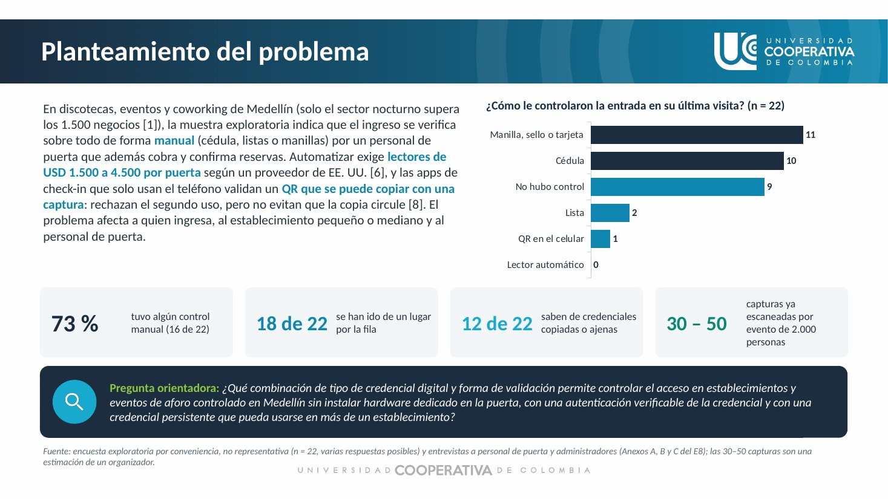
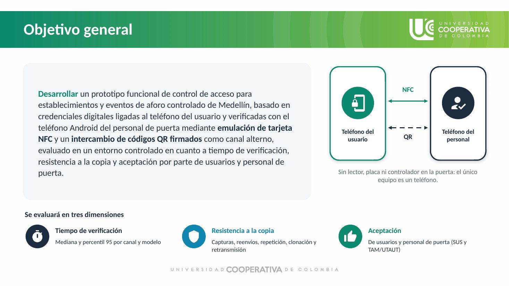
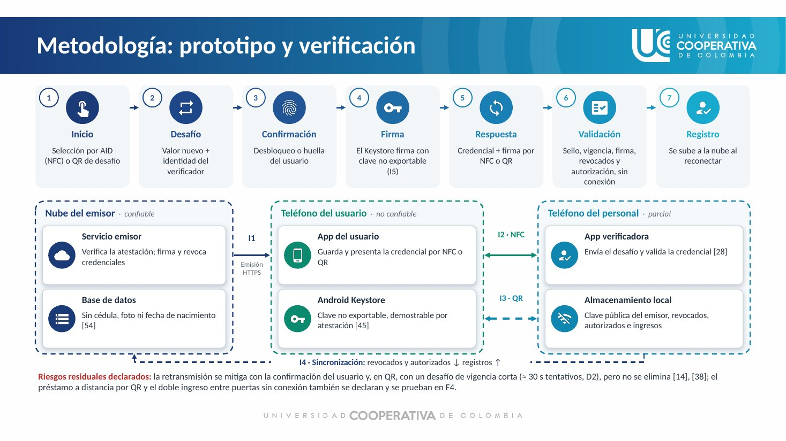

-8DB89C?style=flat-square)

## Qué es

**VIPY** es el anteproyecto de un sistema de control de acceso para discotecas, eventos y coworkings de aforo controlado en Medellín. La idea: una plataforma emite una **credencial digital firmada** que queda guardada en el Android de la persona, y el personal de puerta la verifica **con su propio teléfono**, por **NFC** (emulación de tarjeta, HCE) o, como canal alterno, con un **intercambio de códigos QR firmados**. Funciona incluso sin conexión y no exige instalar lectores en la puerta.

> **Estado actual: en documentación.** Todavía no hay código. Este repositorio reúne la investigación y el diseño (entregas E1 a E8). El prototipo se construirá en la siguiente etapa.

## El problema

- En una encuesta exploratoria (n = 22, no representativa), **16 de 22 personas** pasaron por una revisión manual en su última visita: cédula, lista o manilla.
- Las opciones automáticas obligan a escoger entre **instalar hardware** en la puerta o validar **QR que se copian** con una captura de pantalla.
- En **3 entrevistas** con personal de puerta y administradores supimos que circulan capturas reenviadas y que automatizar se descarta por costo.
- Comparamos **13 alternativas** y definimos una brecha con cuatro condiciones:

| | Condición |
|---|---|
| **C1** | Validar sin hardware dedicado en la puerta |
| **C2** | Autenticar la credencial con desafío-respuesta y una clave ligada al teléfono |
| **C3** | Una credencial persistente que sirva en varios establecimientos |
| **C4** | Declarar y medir la cobertura de teléfonos (NFC o QR) |

## Objetivos

**General.** Desarrollar un prototipo funcional de control de acceso basado en credenciales digitales ligadas al teléfono del usuario y verificadas con el Android del personal de puerta (NFC y QR firmado), evaluado en tiempo de verificación, resistencia a la copia y aceptación.

| | Objetivo específico | Resultado |
|---|---|---|
| OE1 | Requisitos, modelo de amenazas y criterios de aceptación | Requisitos priorizados e informe de compatibilidad |
| OE2 | Arquitectura y protocolo de emisión, verificación y revocación (NFC y QR) | Documento de arquitectura y protocolo |
| OE3 | Prototipo: app del usuario, app del verificador y servicio de emisión | Prototipo versionado de punta a punta |
| OE4 | Evaluación técnica: tiempo, éxito y resistencia a copia, repetición y retransmisión | Informe técnico y de seguridad |
| OE5 | Usabilidad y aceptación en un piloto (≥ 15 usuarios y 3 de personal de puerta) | Informe con SUS y TAM/UTAUT |

## Cómo lo vamos a hacer

Investigación en ciencia del diseño (**DSRM**) durante **16 semanas**, en seis fases con ciclos de dos semanas:

| Fase | Semanas | Producto |
|---|---|---|
| F1 · Caracterización y requisitos | S1–S3 | Requisitos, amenazas e informe de compatibilidad |
| F2 · Arquitectura y protocolo | S3–S5 | APDU, QR de desafío y respuesta, revocación, modo sin conexión |
| F3 · Implementación iterativa | S5–S11 | Kotlin + Android Studio, `HostApduService`, Android Keystore, backend en la nube |
| F4 · Evaluación técnica y de seguridad | S10–S13 | ≥ 30 intentos por canal y modelo, pruebas de relay, revisión MASVS |
| F5 · Piloto de validación | S12–S15 | Tiempos frente al control manual, SUS y TAM/UTAUT |
| F6 · Análisis y comunicación | S15–S16 | Informe final, demostración y repositorio |

## Documentos

| Entrega | Documento |
|---|---|
| E1 | [Idea de investigación](docs/E1-idea-de-investigacion.pdf) |
| E2 | [Rastreo de referencias](docs/E2-rastreo-de-referencias.pdf) |
| E3 | [Planteamiento del problema](docs/E3-planteamiento-del-problema.pdf) |
| E4 | [Marco teórico y estado del arte](docs/E4-marco-teorico-y-estado-del-arte.pdf) |
| E5 | [Objetivos y metodología](docs/E5-objetivos-y-metodologia.pdf) |
| E6 | [Resultados, impacto, cronograma y presupuesto](docs/E6-resultados-impacto-cronograma-presupuesto.pdf) |
| E7 | [Presentación de divulgación (PDF)](docs/E7-divulgacion-anteproyecto.pdf) · [PPTX](docs/E7-divulgacion-anteproyecto.pptx) |
| **E8** | **[Documento final del anteproyecto](docs/E8-documento-final-anteproyecto.pdf)** |
| Anexo D | [Diseño preliminar](docs/anexo-D-diseno-preliminar.pdf) |

Las respuestas crudas de la encuesta, las transcripciones de las entrevistas y las actas de asesoría no se publican porque contienen datos de terceros.

## Análisis y tablero

- **Espacio de trabajo en Google Colab:** [`analisis/vipy_analisis.ipynb`](analisis/vipy_analisis.ipynb) reúne los conteos agregados de la encuesta, las entrevistas, la comparación de alternativas, el cronograma y el presupuesto; los grafica y calcula intervalos de confianza del 95 % (Wilson) para las cifras principales.
- **Tablero interactivo:** [luism7p7.github.io/dashboards/vipy.html](https://luism7p7.github.io/dashboards/vipy.html), con tres páginas (problema en la puerta, teléfonos y alternativas, plan y presupuesto).
- **Datos para Power BI:** [`analisis/datos_powerbi/`](analisis/datos_powerbi) tiene las mismas tablas en CSV (UTF-8) para abrirlas en Power BI Desktop con *Obtener datos → Texto/CSV*.

Las respuestas individuales no se publican; el cuaderno usa solo los conteos que aparecen en el documento final.

## Equipo

- **Ronald García Muñoz**
- **Luis Miguel Muñoz Rendón** · [Portafolio](https://luism7p7.github.io) · [GitHub](https://github.com/luism7p7)

Asesor técnico: Rodolfo Ortega. Curso Ideación, Emprendimiento y Desarrollo Tecnológico · Grupo 08 · Ingeniería de Software · Universidad Cooperativa de Colombia · octubre de 2026.
